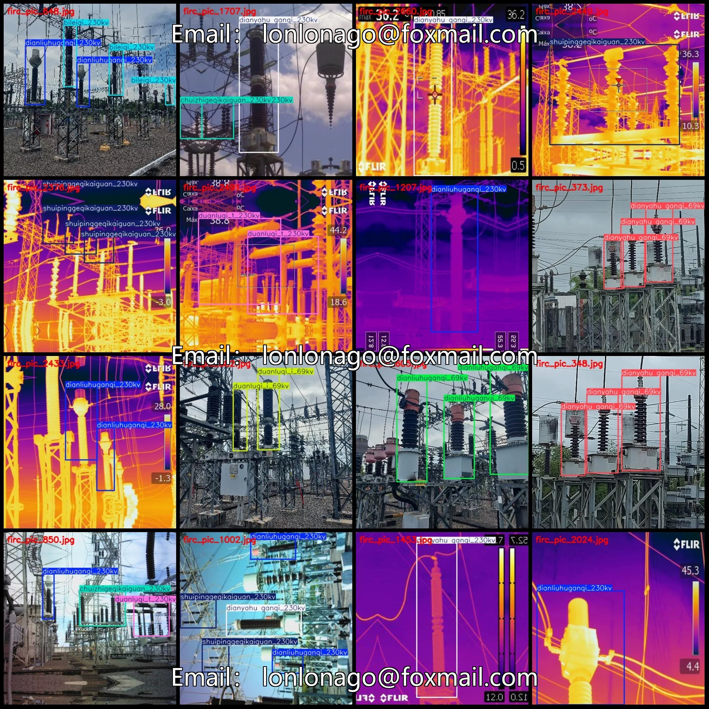
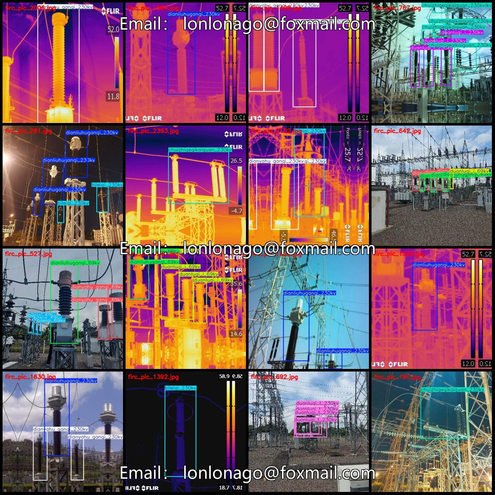
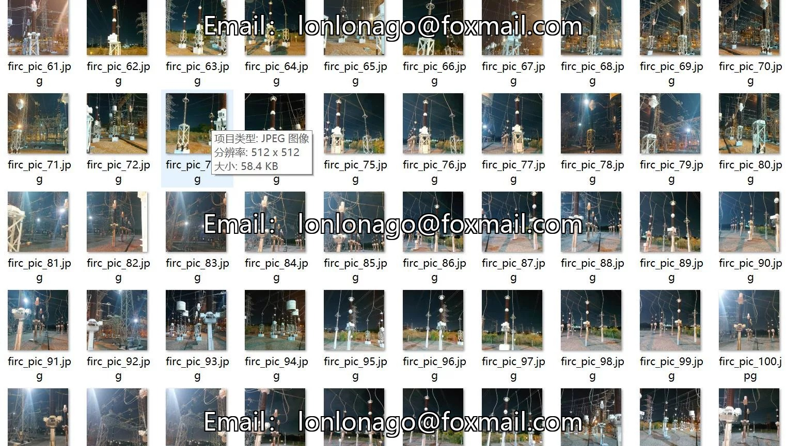
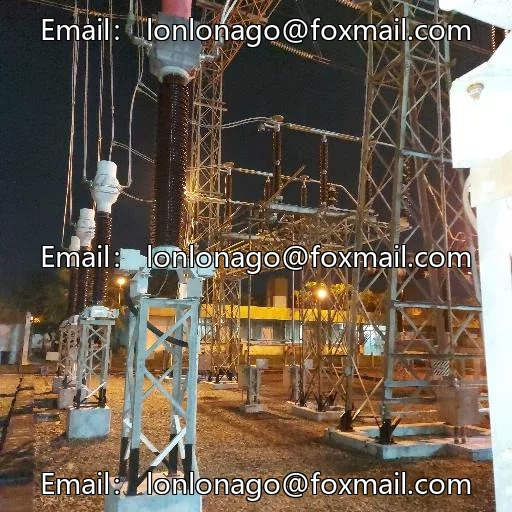
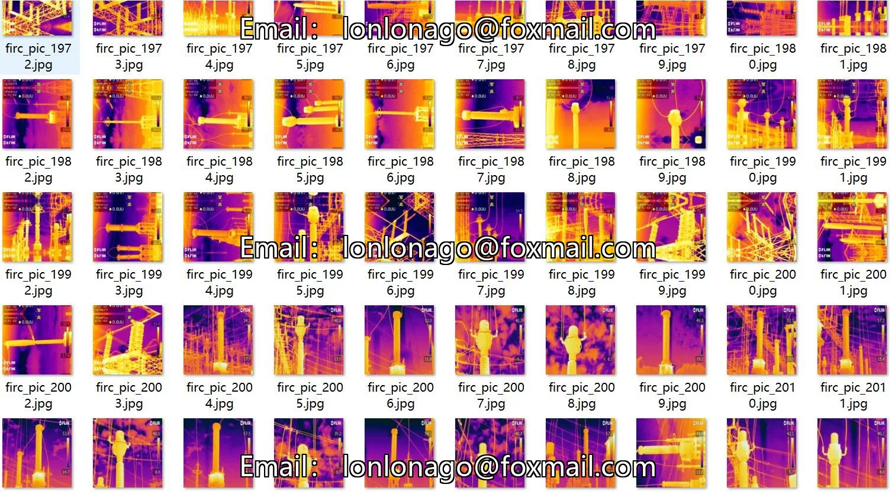
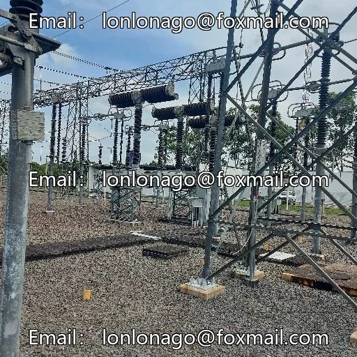
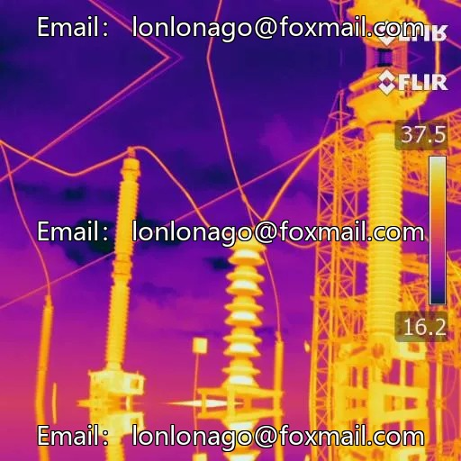

# Power scene infrared visible light image distribution station power facilities element isolation switch lightning protection device inspection number

## Body

Power Scene Infrared and Visibility Image Data Set for Distributed Power Station Electrical Facilities - Isolation Switches and Lightning Surge Protectors Detection Dataset in VOC+YOLO format with 2688 images across 13 categories
Warm Reminder: Since the dataset is copyable, please confirm compliance before purchasing.
Dataset Format: Pascal VOC format + YOLO format (txt file without split path, only containing jpg images along with corresponding VOC format xml files and yolo format txt files)
Number of Images (JPG File Count): 2688
Number of Annotations (XML File Count): 2688
Number of Annotations (TXT File Count): 2688
Number of Annotation Categories: 13

Label category names (Note that the order in YOLO format does not correspond to this, but is based on the classes.txt file in the labels folder): ["bianyaqi", "bileiqi_69kv", "bileiqi_230kv", "chuizhigeqikaiguan_230kv", "dianliuhuganqi_69kv", "dianliuhuganqi_230kv", "dianyahu ganqi_69kv", "dianyahu ganqi_230kv", "duanluqi_i_69kv", "duanluqi_i_230kv"]

duanluqi_t_230kv, geqikaiguan_69kv, shuipinggeqikaiguan_230kv

["Transformer", "Lightning Surge Protector - 69kV", "Lightning Surge Protector - 230kV", "Vertically Disconnecting Switch - 230kV", "Current Transformer - 69kV", "Current Transformer - 230kV", "Voltage Transformer - 69kV", "Voltage Transformer - 230kV", "Breaker - I-69kV", "Breaker - I-230kV", "Breaker - T-230kV", "Disconnecting Switch - 69kV", "Horizontal Disconnecting Switch - 230kV"]
Number of boxes and the number of images occupied by each category
Bianyaqi Frames = 57, Pictures Taken = 50

bileiqi_69kv Frame count = 194, Image count = 97
bileiqi_230kv Frame count = 968, Image count = 509
chuizhigeqikaiguan_230kv Frame count = 847, Image count = 447
dianliuhuganqi_69kv Frame count = 530, Image count = 250
dianliuhuganqi_230kv Frame count = 1707, Image count = 828
dianyahu ganqi_69kv Frame count = 269, Image count = 116

Dianyahu Ganqi_230kv: Frames = 1481, Pictures = 859
Duanluqi_i_69kv: Frames = 747, Pictures = 228
Duanluqi_i_230kv: Frames = 661, Pictures = 291
Duanluqi_t_230kv: Frames = 440, Pictures = 165
Geikaiguan_69kv: Frames = 31, Pictures = 24
ShuipingGeikaiguan_230kv: Frames = 285, Pictures = 147
Total Frames: 8217
Image Resolution: 512x512

Using labeling tool: labelImg
Labeling rules: Draw rectangles around categories.
Important note: The dataset does not have a division into training, validation, and test sets; approximately 1200 visible light images remain, with the remaining being infrared images. It is important to note that visible light and infrared images are not directly interchangeable and cannot be used for registration purposes.
Special declaration: This dataset does not guarantee any accuracy in the models or weight files trained.

## Images

## Payment

Here is a pay link on Stripe ( https://buy.stripe.com/3cs8yP7sY87d0vu9AB ). Please contact me lonlonago@foxmail.com after funding $89, and I will send you a complete data files , thank you!

